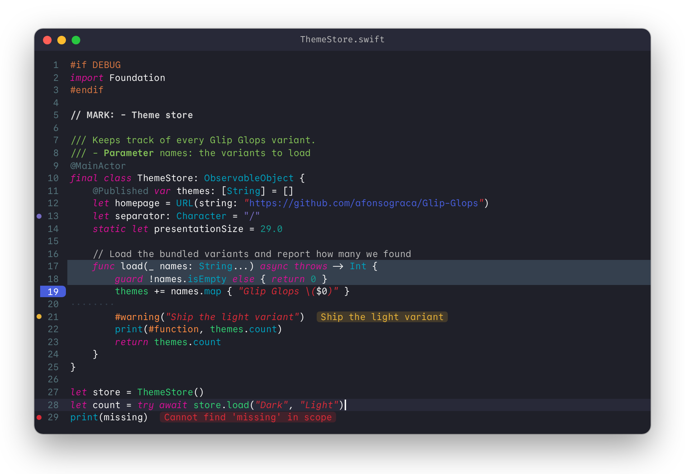
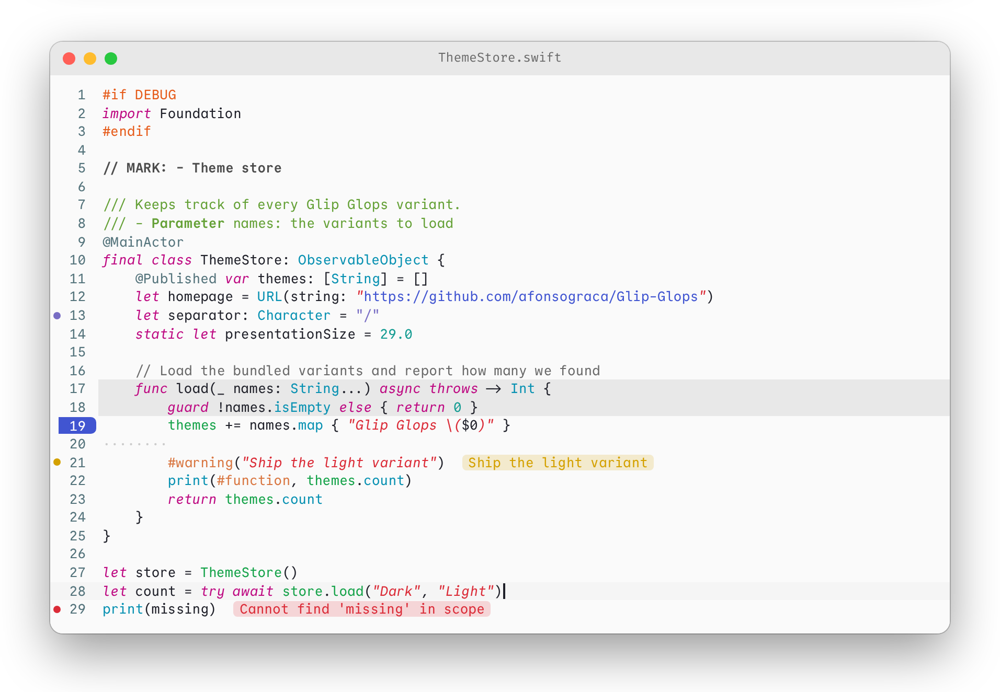
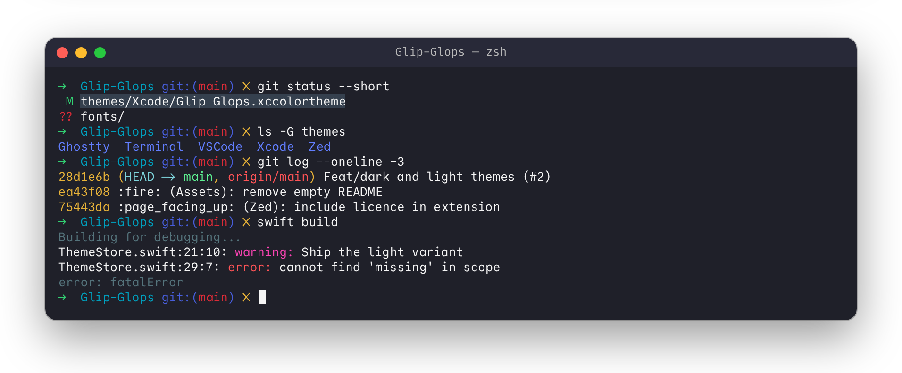
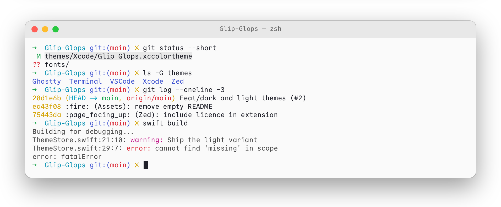

# Glip Glops
Glip Glops is a color theme. It’s like *Xcode*’s **Civic** and **Dusk**  themes had a baby and it was raised by all the other languages you love to code in.

So basically it’s supposed to run pretty much everywhere, bringing you the immense joy of having a unified look throughout your everyday tools.

`TODO vision`

## Palette


## Installation
Every theme comes in **Glip Glops** (dark) and **Glip Glops Light**.

### Font
Glip Glops is designed around [Commit Mono](https://commitmono.com/), with ligatures, arrows, smart kerning, smart case, symbol spacing, and the alternate `a`, `g`, `6`, `9` and italic letters. [fonts](fonts) has two ready-made builds, following Commit Mono's advice of weight 400 for dark mode and 450 for light mode:

- **CommitMono** (400), used by **Glip Glops**
- **CommitMono450** (450), used by **Glip Glops Light**

Install all eight `.otf` files by opening them with Font Book and clicking **Install**. The themes work with any font, but this is how they're meant to look.

Commit Mono is made by Eigil Nikolajsen and released under the [SIL Open Font License](fonts/LICENSE).

### Xcode
Xcode doesn't provide a seamless way to add new themes, so you'll need to copy these [contents](themes/Xcode) into
```
~/Library/Developer/Xcode/UserData/FontAndColorThemes/
```
An easy way to get there is to open a Finder window and use the command `⌘ + ⇧ + G` and paste the path there.

Each variant ships in three sizes: regular (11.5pt), **Presentation** (19pt) and **Presentation Large** (29pt). They use the [Commit Mono builds](#font), so install those first.

### Terminal
Double-click a profile in [themes/Terminal](themes/Terminal), or import it from **Terminal › Settings › Profiles › ⋯ › Import…**, then set it as default.

### Ghostty
Copy the files in [themes/Ghostty](themes/Ghostty) into `~/.config/ghostty/themes/`, then add to your Ghostty config:
```
theme = light:Glip Glops Light,dark:Glip Glops
```
Ghostty switches between them with the system appearance. The themes set the colours and the [font](#font); for the full look, add:
```
background-opacity = 0.8
background-blur = 20
cursor-style = block
cursor-style-blink = true
font-size = 11.5
adjust-cell-height = 12%
```
To use your own font instead, clear the theme's one first, otherwise yours only becomes a fallback:
```
font-family = ""
font-family = Your Font
```

### Zed
Run `zed: install dev extension` from the command palette and pick the [themes/Zed](themes/Zed) folder, or copy [glip-glops.json](themes/Zed/themes/glip-glops.json) into `~/.config/zed/themes/`. Then, in your Zed settings:
```json
"theme": {
  "mode": "system",
  "light": "Glip Glops Light",
  "dark": "Glip Glops"
},
"buffer_font_family": "CommitMono"
```
Zed uses one font for both themes, so pick `CommitMono450` instead if you mostly work in light mode.

### VS Code and Cursor
See [themes/VSCode/glip-glops](themes/VSCode/glip-glops/README.md). For the [font](#font), add to your settings:
```json
"editor.fontFamily": "CommitMono",
"editor.fontLigatures": true
```
Like Zed, they use one font for both themes, so pick `CommitMono450` instead if you mostly work in light mode.

### Slack
In the Slack desktop app, go to **Preferences › Appearance › Custom theme** and enter the colours from [themes/Slack](themes/Slack/README.md). Use **Glip Glops Light** only with Slack's light colour mode; in dark mode Slack draws its own dark navigation. If you're in several workspaces, the same page has accent colours to tell them apart.

## Contributing
Contributions are welcome! Read the [contributing guidelines](CONTRIBUTING.md) to get started, and please follow our [Code of Conduct](CODE_OF_CONDUCT.md).

## Screenshots
Xcode and Terminal with the [Commit Mono builds](#font).

| Glip Glops | Glip Glops Light |
| --- | --- |
|  |  |
|  |  |

## Acknowledgements
This README and the [contributing guidelines](CONTRIBUTING.md) are inspired by [Moya](https://github.com/Moya/Moya) and its [contributors guide](https://github.com/moya/contributors).

## License
Glip Glops is released under an MIT license. See [LICENSE](https://github.com/afonsograca/Glip-Glops/blob/main/LICENSE) for more information. The Commit Mono fonts in [fonts](fonts) are released under the [SIL Open Font License](fonts/LICENSE).