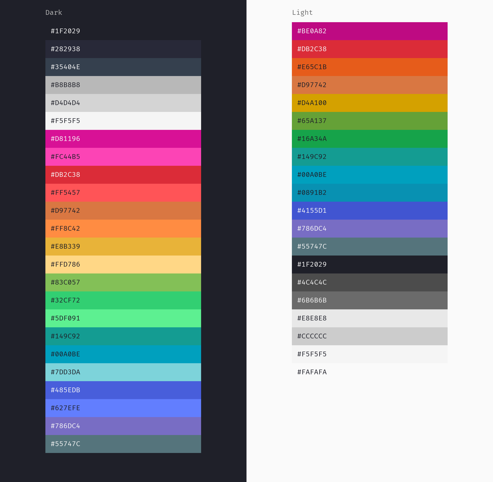

# Glip Glops
Glip Glops is a color theme. It’s like *Xcode*’s **Civic** and **Dusk**  themes had a baby and it was raised by all the other languages you love to code in.

So basically it’s supposed to run pretty much everywhere, bringing you the immense joy of having a unified look throughout your everyday tools.

`TODO vision`

## Palette


## Installation
Every theme comes in **Glip Glops** (dark) and **Glip Glops Light**.

### Xcode
Xcode doesn't provide a seamless way to add new themes, so you'll need to copy these [contents](themes/Xcode) into
```
~/Library/Developer/Xcode/UserData/FontAndColorThemes/
```
An easy way to get there is to open a Finder window and use the command `⌘ + ⇧ + G` and paste the path there.

Each variant ships in three sizes: regular (11pt), **Presentation** (18pt) and **Presentation Large** (28pt). They use [Fira Code](https://github.com/tonsky/FiraCode), so install it first.

### Terminal
Double-click a profile in [themes/Terminal](themes/Terminal), or import it from **Terminal › Settings › Profiles › ⋯ › Import…**, then set it as default.

### Ghostty
Copy the files in [themes/Ghostty](themes/Ghostty) into `~/.config/ghostty/themes/`, then add to your Ghostty config:
```
theme = light:Glip Glops Light,dark:Glip Glops
```
Ghostty switches between them with the system appearance. The themes only set colours; for the full look, add:
```
background-opacity = 0.8
background-blur = 20
cursor-style = block
cursor-style-blink = true
font-family = Fira Code
font-style = Retina
font-size = 11
```

### Zed
Run `zed: install dev extension` from the command palette and pick the [themes/Zed](themes/Zed) folder, or copy [glip-glops.json](themes/Zed/themes/glip-glops.json) into `~/.config/zed/themes/`. Then, in your Zed settings:
```json
"theme": {
  "mode": "system",
  "light": "Glip Glops Light",
  "dark": "Glip Glops"
}
```

### VS Code
See [themes/VSCode/glip-glops](themes/VSCode/glip-glops/README.md).

## Contributing
Contributions are welcome! Read the [contributing guidelines](CONTRIBUTING.md) to get started, and please follow our [Code of Conduct](CODE_OF_CONDUCT.md).

## Screenshots
`TODO`

## Acknowledgements
`TODO mention repo inspiration in Cocoapods Moya`

## License
Glip Glops is released under an MIT license. See [LICENSE](https://github.com/afonsograca/Glip-Glops/blob/main/LICENSE) for more information.